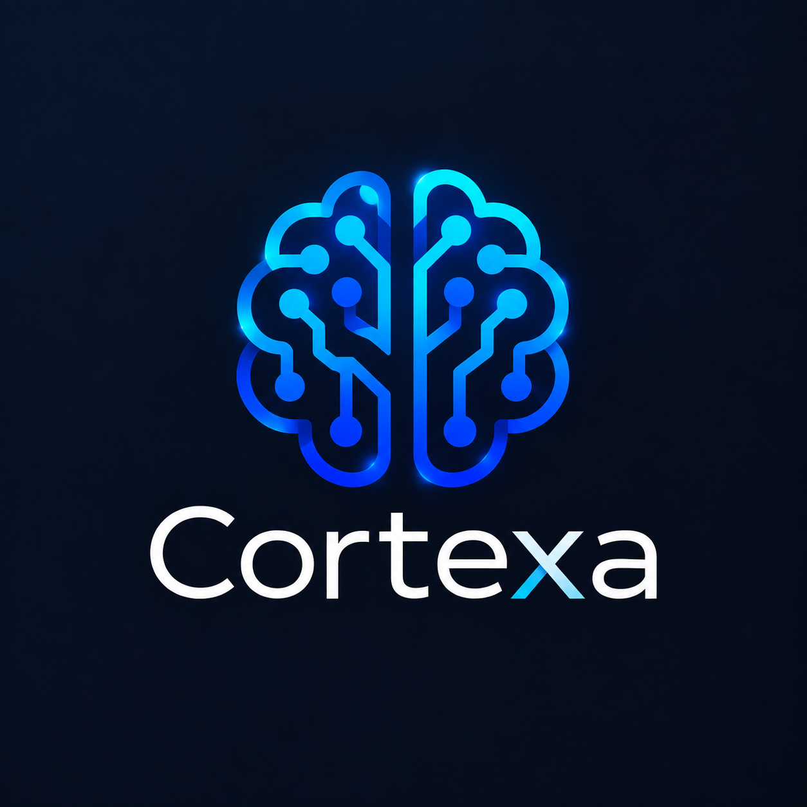

# Cortexa

[](https://github.com/SillyRbbit/ai-agent-assistant/actions/workflows/ci.yml)
[](https://github.com/SillyRbbit/ai-agent-assistant/actions/workflows/documentation.yml)



Cortexa is a private, local-first desktop assistant built with Tauri, React,
TypeScript and Rust. It provides configurable bots, bounded text conversations,
fixed collaboration workflows and a local Knowledge workspace. Models and the
WebView are untrusted; Rust owns validation and application control.

## What currently works

Documentation baseline: GitHub `main` at
`26447708934ef7f8118329d1b62977d7f14d45b6`, inspected on 2026-10-12.

- Nine bots with saved identity, personality, provider/model/reasoning settings
  and explicit private notes. Conductor presents application coordination.
- Native bot chat with Simulation, OpenAI API, Anthropic API, LM Studio,
  Ollama and headless Codex adapters, subject to owner setup and runtime access.
  Streaming, cancellation and sanitized errors are implemented.
- Four fixed collaboration routes with validated handoffs, persisted rooms and
  a read-only Command Center graph of recorded runs.
- Knowledge notes and selected Markdown/text snapshots, versions, lexical passage
  search, internal links/backlinks, properties and explicit workflow source selection.
- SQLite-backed profiles, notes, rooms and Knowledge; local content-free diagnostics.

The **Conversations** workspace still contains a deterministic mock interaction.
Live bot chat is in **Bots**. Tasks and Integrations remain placeholders. The
[capability and evidence matrix](ARCHITECTURE.md#current-and-future-capability-matrix)
distinguishes merged features, simulations, candidate-only work and verification.

## Setup and launch

Native development targets macOS 14+; retained arm64 build evidence does not
establish support for every Mac. Install Xcode command-line tools, Node.js
`26.3.0`, npm `11.16.0` and Rust `1.90.0` with Clippy/rustfmt. Accepted Node/npm
ranges are in [package.json](package.json); Rust is pinned in
[rust-toolchain.toml](rust-toolchain.toml).

```bash
npm ci
npm run tauri -- dev
```

This starts Vite and the native debug application. `npm run dev` alone starts the
browser presentation and does not supply native IPC. Setup/launch commands were
checked against configuration during this documentation audit, **not executed**.
See the [provider setup guide](docs/provider-milestone.md#current-provider-guide--2026-10-12)
before using a live connection. Hosted adapters require a debug build and private
owner configuration; choosing or saving a profile is not proof of authentication.

## Acceptance and limitations

This remains an unsigned personal development application. Retained source/build
bound QA records OpenAI/Codex completion, streaming, Stop/recovery and the research
route; other provider/route variants are not fully live verified. Those results
apply to their recorded artifacts, not every later build. This audit ran no app,
provider request or build. Details are in [TESTING_GUIDE.md](TESTING_GUIDE.md).

Individual bot chat history is volatile on this baseline. Persistent conversations
and newer per-bot memory are active, unmerged work. Memory Off excludes the saved
note from chat context without deleting it. Collaboration excludes private notes.
Knowledge search is lexical, not embedding-based RAG; selected content is sent
only through the explicit workflow source boundary. Models cannot browse, run
commands, edit files or execute their proposed actions on merged main.

Review [SECURITY.md](SECURITY.md) for configured controls and known enforcement
limits. No signed/notarized release, production support, product gateway,
privileged integrations or general action executor is established.

## Development and documentation

For documentation-only edits:

```bash
npm run docs:check
npm run repository:check
npm run security:scan
git diff --check
```

Product changes use the applicable risk-based checks in
[ENGINEERING_GUIDE.md](ENGINEERING_GUIDE.md) and [TESTING_GUIDE.md](TESTING_GUIDE.md);
`npm run verify` is the full local gate. CI complements local acceptance. Linux
jobs route main to `cortexa-linux` and development refs to `cortexa-ci`; target-Mac
Rust retains its own route. See the [runner guide](docs/github/SELF_HOSTED_RUNNER.md).

Start with the [documentation index](docs/README.md), [project status](PROJECT_STATUS.md),
[handoff](HANDOFF.md), [next steps](NEXT_STEPS.md),
[troubleshooting](docs/workflows/TROUBLESHOOTING.md), and
[contributor guide](CONTRIBUTING.md). Developer-installed ECC assists repository
work; it is not a Cortexa bot framework or application integration.

Compatibility identifiers retain `ai-agent-assistant` and
`com.aiagentassistant.desktop`. No open-source license is granted; see the
[licensing record](docs/github/LICENSING.md). Current branding is documented in
[brand guidelines](docs/branding/BRAND_GUIDELINES.md).
